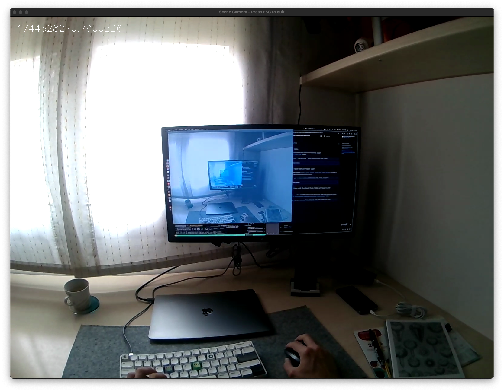
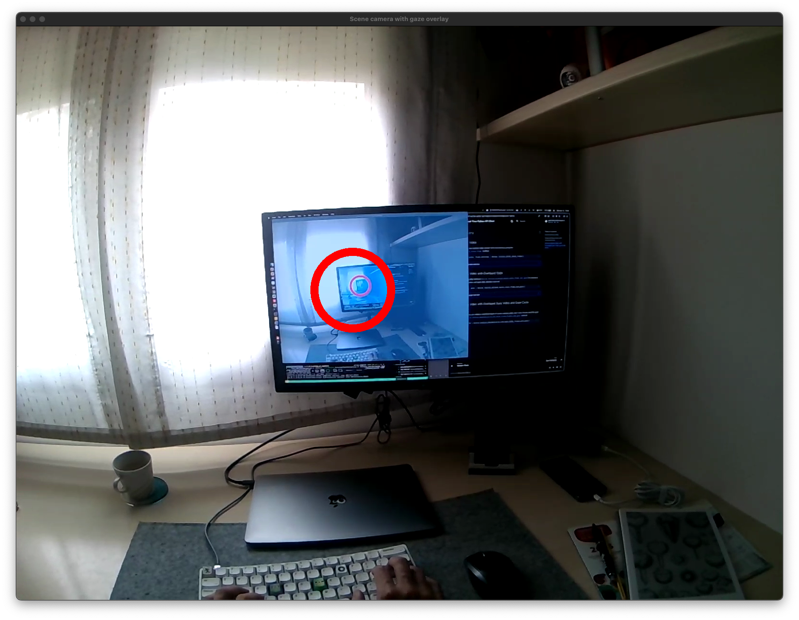
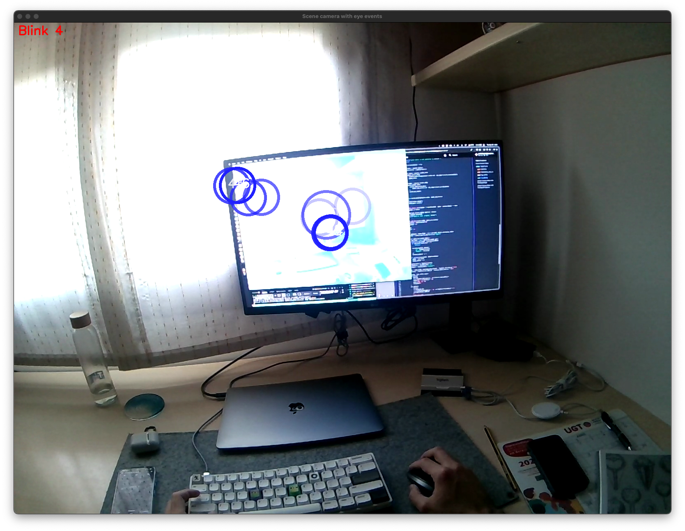

## Scene Camera Video

You can receive the scene camera video stream with timestamps, using the [`receive_video_frames`][pupil_labs.realtime_api.streaming.receive_video_frames] method.

```py linenums="0"
async for frame in receive_video_frames(
	sensor_world.url, run_loop=restart_on_disconnect
):
	bgr_buffer = frame.bgr_buffer()
```

<figure markdown="span">
{ width=500,loading=lazy }
</figure>

??? quote "VideoFrame"

    ::: pupil_labs.realtime_api.streaming.video.VideoFrame

??? example "Check the whole example code here"

    ```py title="stream_scene_camera_video.py" linenums="1"
    --8<-- "examples/async/stream_scene_camera_video.py"
    ```

## Scene Camera Video with Overlayed Gaze

The following example shows how you can match multiple sensors streams by qeueing (`asyncio.Queue()`) and matching the data.

<figure markdown="span">
{  width=500,loading=lazy }
</figure>

??? example "Check the whole example code here"

    ```py title="stream_video_with_overlayed_gaze.py" linenums="0"
    --8<-- "examples/async/stream_video_with_overlayed_gaze.py"
    ```

## Scene Camera Video with Overlayed Fixations or Other Streams

<!-- badge:product Neon -->
<!-- badge:companion +2.9.0 -->
<!-- badge:version +1.5.0 -->

You can do this with any streams, eye cameras or including eye events (blinks, or fixations data).

<figure markdown="span">
{  width=500,loading=lazy }
</figure>

??? example "Check the whole example code here"

    ```py title="stream_video_with_overlayed_fixations.py" linenums="1"
    --8<-- "examples/async/stream_video_with_overlayed_fixations.py"
    ```

## Camera Controls

<!-- badge:product Neon -->
<!-- badge:version +1.9.0 -->

You can get and set scene camera parameters, such as auto exposure mode, manual exposure time, gain, brightness, contrast, and gamma, using [`device.get_camera_state`][pupil_labs.realtime_api.device.Device.get_camera_state] and [`device.set_camera_state`][pupil_labs.realtime_api.device.Device.set_camera_state].

!!! note

    Initiate the video stream (e.g. by receiving the first video frame) or open the scene video preview in the Companion app before querying or setting camera controls to ensure the camera is active.

```py linenums="0"
# Retrieve current camera state
state = await device.get_camera_state()

# Update camera controls
await device.set_camera_state(
    ae_mode="auto",
    man_exp=50,
    gain=50,
    brightness=0,
    contrast=70,
    gamma=300,
    validate_with_state=state,
)
```

??? quote "CameraState"

    ::: pupil_labs.realtime_api.camera_control.CameraState

??? quote "ControlStateEnum"

    ::: pupil_labs.realtime_api.camera_control.ControlStateEnum

??? quote "ControlStateInteger"

    ::: pupil_labs.realtime_api.camera_control.ControlStateInteger

??? example "Check the whole example code here"

    ```py title="device_camera_controls.py" linenums="1"
    --8<-- "examples/async/device_camera_controls.py"
    ```
