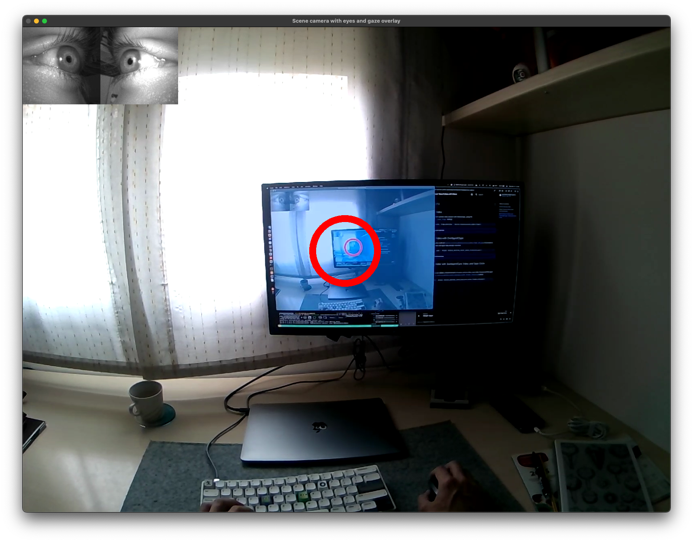

### Scene Camera Video

It's very easy to stream the scene camera feed with timestamps for real-time monitoring. Simply use the [`device.receive_scene_video_frame`][pupil_labs.realtime_api.simple.Device.receive_scene_video_frame] method.

```py linenums="0"
bgr_pixels, frame_datetime = device.receive_scene_video_frame()
```

<figure markdown="span">
{ width=500,loading=lazy }
</figure>

??? quote "SimpleVideoFrame"

    ::: pupil_labs.realtime_api.simple.SimpleVideoFrame

??? example "Check the whole example code here"

    ```py title="stream_scene_camera_video.py" linenums="1"
    --8<-- "examples/simple/stream_scene_camera_video.py"
    ```

### Scene Camera Video with Overlayed Gaze

For additional context about where the wearer was gazing, it's useful to overlay gaze measurements onto the scene camera video stream. Since the scene camera and gaze signal can have different sampling rates, we need to be sure they are matched. For that, you can use ([`device.receive_matched_scene_video_frame_and_gaze`][pupil_labs.realtime_api.simple.Device.receive_matched_scene_video_frame_and_gaze]).
This receives a pair of scene camera video and gaze data already matched.

```py linenums="0"
frame, gaze = device.receive_matched_scene_video_frame_and_gaze()
```

<figure markdown="span">
{  width=500,loading=lazy }
</figure>

??? quote "MatchedItem"

    ::: pupil_labs.realtime_api.simple.MatchedItem

??? example "Check the whole example code here"

    ```py title="stream_video_with_overlayed_gaze.py" linenums="1"
    --8<-- "examples/simple/stream_video_with_overlayed_gaze.py"
    ```

### Scene Camera Video with Overlayed Eyes Video and Gaze Circle

<!-- badge:product Neon -->

It might also be useful to overlay the eye camera video frames, e.g. if you want to manually inspect the eye data or blinking behaviour. This can be achieved using the [`device.receive_matched_scene_and_eyes_video_frames_and_gaze`][pupil_labs.realtime_api.simple.Device.receive_matched_scene_and_eyes_video_frames_and_gaze] method.

```py linenums="0"
matched = device.receive_matched_scene_and_eyes_video_frames_and_gaze()
```

<figure markdown="span">
{  width=500,loading=lazy }
</figure>

??? quote "MatchedGazeEyesSceneItem"

    ::: pupil_labs.realtime_api.simple.MatchedGazeEyesSceneItem

??? example "Check the whole example code here"

    ```py title="stream_scene_eyes_and_gaze.py" linenums="1"
    --8<-- "examples/simple/stream_scene_eyes_and_gaze.py"
    ```

### Camera Controls

<!-- badge:product Neon -->
<!-- badge:version +1.9.0 -->

You can get and set scene camera parameters, such as auto exposure mode, manual exposure time, gain, brightness, contrast, and gamma, using [`device.get_camera_state`][pupil_labs.realtime_api.simple.Device.get_camera_state] and [`device.set_camera_state`][pupil_labs.realtime_api.simple.Device.set_camera_state].

!!! note

    Initiate the video stream (e.g. by calling `device.receive_scene_video_frame()`) or open the scene video preview in the Companion app before querying or setting camera controls to ensure the camera is active.

```py linenums="0"
# Retrieve current camera state
camera_state = device.get_camera_state()

# Update camera controls
device.set_camera_state(
    ae_mode="manual",
    man_exp=500,
    gain=64,
    brightness=0,
    contrast=32,
    gamma=300,
    validate_with_state=camera_state,
)
```

??? quote "CameraState"

    ::: pupil_labs.realtime_api.camera_control.CameraState

??? quote "ControlStateEnum"

    ::: pupil_labs.realtime_api.camera_control.ControlStateEnum

??? quote "ControlStateInteger"

    ::: pupil_labs.realtime_api.camera_control.ControlStateInteger

??? example "Check the whole example code here"

    ```py title="camera_controls.py" linenums="1"
    --8<-- "examples/simple/camera_controls.py"
    ```

<!-- ### Scene Camera Video with Overlayed Fixations

<!-- badge:product Neon -->
<!-- badge:companion +2.9.0 -->
<!-- badge:version +1.5.0 -->

Although there is no convenience method to receive a matched scene camera video with fixation data, here is an example of
how you can implement it yourself.

??? example "Check the whole example code here"

    ```py title="stream_video_with_overlayed_fixations.py" linenums="1"
    #--8<-- "examples/simple/stream_video_with_overlayed_fixations.py"
    ```
    -->
